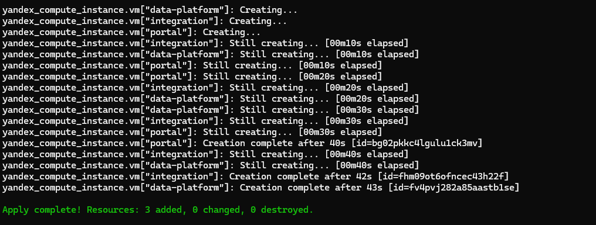
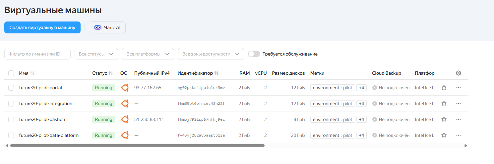
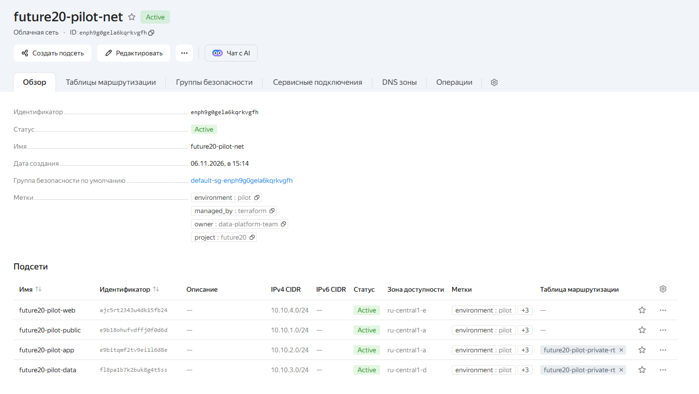
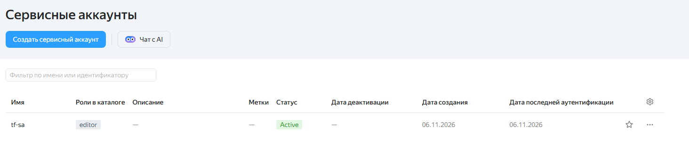

# Задание 4. Облачная инфраструктура «Будущее 2.0» (IaaS, Terraform, Yandex Cloud)

Инфраструктура пилота описана кодом и развёрнута в Yandex Cloud командой `terraform apply`. Ниже: что создаётся, как это запустить и что получилось.

## Результат запуска

Команда, которой развёрнута инфраструктура:

```bash
terraform apply -var-file="quota-20gb-3zones.tfvars" -var-file="quota-small-vm.tfvars"
```

Она завершилась успешно: `Apply complete!` и блок `Outputs` с идентификаторами и адресами.



*Рис. 1. Успешное завершение `terraform apply` (`Apply complete!` и блок `Outputs`).*

Созданные ресурсы в веб-консоли Yandex Cloud:



*Рис. 2. Консоль Yandex Cloud: созданные Terraform ресурсы.*



*Рис. 3. Консоль Yandex Cloud: созданные Terraform ресурсы (продолжение).*



*Рис. 4. Консоль Yandex Cloud: созданные Terraform ресурсы (продолжение).*

## Состав папки

| Файл | Назначение |
|------|-----------|
| `main.tf` | Описание инфраструктуры: сеть, подсети, NAT-шлюз, группы безопасности, адреса, диски, ВМ, снимки |
| `variables.tf` | Переменные с описаниями и проверками входных данных |
| `outputs.tf` | Ключевые параметры: идентификаторы, внутренние и публичные адреса, команда SSH, диски |
| `terraform.tfvars` | Базовые значения переменных пилота (проектные размеры) |
| `quota-20gb-3zones.tfvars` | Зоны и диски под квоты облака: HDD не больше 20 ГБ на зону (зоны `a`, `d`, `e`) |
| `quota-small-vm.tfvars` | Размеры ВМ под квоты облака: каждая 2 vCPU, 2 ГБ памяти |
| `fallback-hdd-one-zone.tfvars`, `minimal-quota.tfvars` | Другие запасные варианты значений (одна зона, диски HDD); в итоговом запуске не использовались |
| `diagram.png`, `diagram.puml` | Диаграмма автоматизации: что создаёт Terraform, а что делается вручную |
| `justification.md` | Обоснование размеров, дисков, NAT, декларативного подхода и IaC |
| `tests/pilot.tftest.hcl` | Тесты конфигурации с имитацией провайдера (без обращения к облаку) |
| `apply_screenshot.png` | Скриншот успешного `terraform apply` |
| `yandex_cloud1.png`, `yandex_cloud2.png`, `yandex_cloud3.png` | Скриншоты веб-консоли Yandex Cloud с созданными ресурсами |
| `.gitignore` | Исключает состояние Terraform и ключи из репозитория |

## Что создаётся

21 ресурс: сеть, 4 подсети, NAT-шлюз, таблица маршрутов, 3 группы безопасности, 2 статических публичных адреса, 4 диска данных, 4 ВМ (`bastion`, `integration`, `data-platform`, `portal`), расписание снимков дисков.

Размещение в итоговом запуске:

| Зона | Подсеть | ВМ и диски | HDD в зоне |
|------|---------|-----------|-----------|
| `ru-central1-a` | `public`, `app` | `bastion` (загрузочный 8 ГБ), `integration` (загрузочный 8 ГБ, диск `kafka` 4 ГБ) | 20 из 20 ГБ |
| `ru-central1-d` | `data` | `data-platform` (загрузочный 8 ГБ, диски `clickhouse` 6 ГБ и `lake` 6 ГБ) | 20 из 20 ГБ |
| `ru-central1-e` | `web` | `portal` (загрузочный 8 ГБ, диск `bi-data` 4 ГБ) | 12 из 20 ГБ |

Все ВМ в итоговом запуске имеют 2 vCPU (доля 20%) и 2 ГБ памяти, все диски типа `network-hdd`. Публичные адреса получают только `bastion` и `portal`; `integration` и `data-platform` стоят в приватных подсетях и выходят в интернет через NAT-шлюз.

### Почему размеры маленькие

Проектные размеры (SSD, ВМ до 8 vCPU и 32 ГБ, диск озера данных 200 ГБ) записаны в `terraform.tfvars` и обоснованы в `justification.md`. Но квоты облака, в котором выполнялся запуск, ограничены:

- HDD: 20 ГБ в каждой из зон `a`, `d`, `e`; в зоне `b` квота не выделена;
- SSD, число ядер и объём памяти в зонах тоже ограничены (первые попытки с большими размерами закончились ошибками `ResourceExhausted`).

Поэтому для запуска размеры уменьшены через отдельные файлы значений. Код (`main.tf`, `variables.tf`) при этом не менялся: подход тот же, различаются только числа. Для рабочей среды достаточно запустить `terraform apply` с базовым `terraform.tfvars` в облаке с обычными квотами.

## Что проверено

| Проверка | Статус |
|----------|--------|
| `fmt`, `validate` | Пройдены (OpenTofu 1.10.6, провайдер `yandex-cloud/yandex` 0.200.0) |
| Тесты с имитацией провайдера: полный `apply`, привязка NAT, публичные адреса, зоны, отказ на неверных данных | Пройдены |
| `terraform init`, `plan`, `apply` в реальном Yandex Cloud | Выполнены, `apply` завершился успешно (скриншот выше) |

## Как запустить в своём облаке

### 1. Подготовка (один раз, вручную)

1. Установите Terraform версии 1.5 или новее (подойдёт и OpenTofu).
2. Установите [CLI `yc`](https://yandex.cloud/ru/docs/cli/quickstart), выполните `yc init`, затем `yc config list` покажет `cloud-id` и `folder-id`.
3. Создайте сервисный аккаунт и дайте ему роль `editor` на каталог (учебный вариант; для рабочей среды выдают более узкие роли), затем создайте ключ:

   ```bash
   yc iam service-account create --name tf-sa
   yc resource-manager folder add-access-binding <folder-id> --role editor --subject serviceAccount:<id аккаунта>
   yc iam key create --service-account-name tf-sa --output key.json
   export YC_SERVICE_ACCOUNT_KEY_FILE=$PWD/key.json   # файл key.json в репозиторий не добавлять
   ```

   В PowerShell: `$env:YC_SERVICE_ACCOUNT_KEY_FILE = "D:\путь\к\key.json"`. Путь должен указывать на существующий файл.
4. Если нет SSH-ключа: `ssh-keygen -t ed25519`.
5. Откройте `terraform.tfvars` и замените значения с пометкой «ЗАМЕНИТЬ»: `cloud_id`, `folder_id`, `admin_cidr_blocks` (ваш внешний адрес в виде `x.x.x.x/32`) и `portal_allowed_cidrs`.

Если `registry.terraform.io` недоступен из вашей сети, используйте зеркало провайдеров из документации Yandex Cloud.

### 2. Развёртывание

В облаке с обычными квотами:

```bash
cd Task4
terraform init
terraform plan
terraform apply
```

В облаке с малыми квотами (как в нашем запуске): значения из второго и третьего файла переопределяют `subnets` и `vms` из `terraform.tfvars`. Порядок файлов важен, последний имеет приоритет:

```bash
terraform apply -var-file="quota-20gb-3zones.tfvars" -var-file="quota-small-vm.tfvars"
```

Проверьте квоты облака заранее: консоль Yandex Cloud → «Квоты» (диски HDD и SSD, vCPU, память по зонам). При ошибках `ResourceExhausted` уменьшите размеры в файлах значений или запросите увеличение квоты в поддержке.

Итог: `Apply complete!`, затем блок `Outputs` с адресами и идентификаторами.

### 3. Проверка и очистка

```bash
terraform output bastion_ssh_command   # команда подключения к бастиону
terraform destroy -var-file="quota-20gb-3zones.tfvars" -var-file="quota-small-vm.tfvars"   # удалить ресурсы, чтобы не платить за простой
```

Команда `destroy` должна получать те же файлы значений, что и `apply`.

### 4. Тесты без облака (по желанию)

Нужен Terraform 1.7 или новее (или OpenTofu) и публичный SSH-ключ по пути из `ssh_public_key_path`:

```bash
terraform init
terraform test -var-file=terraform.tfvars
```

## Чек-лист для пул-реквеста

- [x] `Task4/main.tf`, `variables.tf`, `outputs.tf`, `terraform.tfvars`, `diagram.png`, `justification.md`
- [x] `Task4/quota-20gb-3zones.tfvars` и `quota-small-vm.tfvars` (значения, с которыми выполнен запуск)
- [ ] `Task4/apply_screenshot.png` (результат реального `terraform apply`)
- [ ] `Task4/yandex_cloud1.png`, `yandex_cloud2.png`, `yandex_cloud3.png` (скриншоты консоли, на них ссылается README)
- [ ] В репозитории нет `key.json`, файлов `*.tfstate` и каталога `.terraform/`; файл `.terraform.lock.hcl` добавлен
